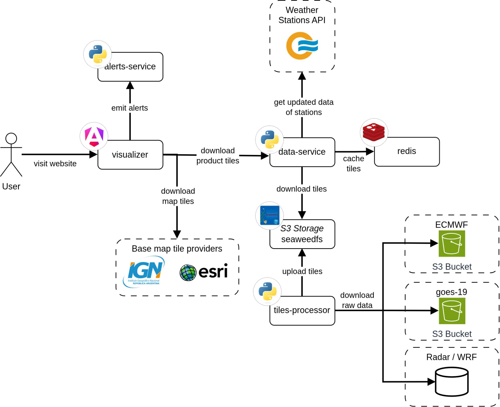

# MapaSMN

Este repositorio reúne los cuatro componentes de MapaSMN y fija la versión de cada uno mediante submódulos de Git. Su función es permitir que una instalación completa se configure desde un solo archivo y se ejecute como un proyecto de Docker Compose. El código de aplicación continúa en los repositorios de `tiles-processor`, `data-service`, `alerts-service` y `visualizer`.

El perfil recomendado para una primera instalación es Beta-1. Fue preparado para una máquina virtual con 8 GB de memoria y mantiene el circuito completo del sistema. Recibe datos meteorológicos reales, los procesa, los publica mediante las API y permite generar avisos desde el visualizador. Para reducir el consumo, utiliza dos workers y habilita una selección acotada de productos.

El perfil productivo ejecuta el catálogo completo y utiliza cinco workers de procesamiento. Para levantar todos los servicios con caché se esperan al menos 8 cores y 24 GB de RAM. Se inicia con `make prod` y permite utilizar tanto el MySQL incluido como una instancia del organismo. El procedimiento se detalla en la [guía de despliegue productivo](./despliegue-a-produccion.md).

La documentación técnica completa se publica con el visualizador. La sección [Beta-1, el sistema completo y liviano](https://github.com/fiuba-tp-g153-smn/visualizer/blob/main/docs/tecnica/operacion/beta-1.md) explica el criterio con el que se armó este perfil.

<p align="center">
    
</p>

## Contenidos

- [Requisitos](#requisitos)
- [Primera puesta en marcha de Beta-1](#primera-puesta-en-marcha-de-beta-1)
  - [Clonar la versión](#clonar-la-versión)
  - [Preparar la configuración](#preparar-la-configuración)
  - [Definir las entradas meteorológicas](#definir-las-entradas-meteorológicas)
  - [Preparar la marca de agua del SMN](#preparar-la-marca-de-agua-del-smn)
  - [Iniciar el sistema](#iniciar-el-sistema)
- [Verificación](#verificación)
- [Operación habitual](#operación-habitual)
- [Puertos y exposición](#puertos-y-exposición)
- [Producción completa y desarrollo](#producción-completa-y-desarrollo)

## Requisitos

La máquina debe tener Docker Engine, Docker Compose 2.20 o posterior, Git, `make`, un shell POSIX y `envsubst`, incluido en GNU gettext. También necesita espacio para los datos crudos, el almacén de objetos, Redis y MySQL. La ejecución productiva de todos los servicios con caché requiere al menos 8 cores y 24 GB de RAM, sus requisitos se detallan en la [guía de producción](./despliegue-a-produccion.md).

En Debian o Ubuntu, las herramientas auxiliares se instalan con:

```sh
sudo apt-get install -y git make gettext-base
docker compose version
```

## Primera puesta en marcha de Beta-1

### Clonar la versión

Cada commit de este repositorio apunta a una revisión determinada de los cuatro componentes. Por este motivo, el clon debe incluir los submódulos.

```sh
git clone --recurse-submodules git@github.com:fiuba-tp-g153-smn/mapasmn.git
cd mapasmn
```

Si el repositorio ya había sido clonado sin ellos:

```sh
git submodule update --init --recursive
```

### Preparar la configuración

El siguiente comando crea el `.env` de la raíz y deriva los archivos que espera cada componente:

```sh
make setup
```

El operador sólo debe editar el `.env` de la raíz. Los archivos `.env` de los submódulos se generan de nuevo con cada ejecución de `make setup`.

Antes de iniciar el sistema se deben reemplazar la contraseña compartida de los servicios internos, las credenciales del SMN y las direcciones que utilizará el navegador. `DEV_PASSWORD` se utiliza como contraseña compartida de las cuentas internas, también en producción: SeaweedFS, RabbitMQ, la pasarela de métricas, Redis, MySQL incluido y la administración de estaciones. Las credenciales del MySQL externo y de la API del SMN se configuran por separado. Se inserta en comandos y en SQL, por lo que no puede contener espacios, comillas ni `$`; `python -c 'import secrets; print(secrets.token_urlsafe(32))'` genera una válida. Un ejemplo mínimo es el siguiente:

```dotenv
APP_ENV=production
DEV_PASSWORD=<una-clave-larga-y-aleatoria>

SMN_API_BASE_URL=<endpoint-asignado-por-el-SMN>
SMN_API_USERNAME=<usuario>
SMN_API_PASSWORD=<clave>

DATA_SERVICE_BASE_URL=http://mapasmn.example.org:6006
ALERTS_SERVICE_BASE_URL=http://mapasmn.example.org:6007
METRICS_SERVICE_BASE_URL=http://mapasmn.example.org:6020
DOCS_URL=/docs-site
```

Las tres direcciones de servicios quedan incorporadas al visualizador durante la construcción. Deben ser accesibles desde la computadora del usuario. Si el mapa se abre desde otra máquina, `localhost` apunta a esa máquina y no al servidor donde corre MapaSMN.

### Definir las entradas meteorológicas

El objetivo de Beta-1 es conectar la mayor cantidad posible de productos con las fuentes disponibles en la instalación. `settings-beta-1.json` define el modo y la ubicación de cada una. El archivo versionado constituye un punto de partida, no una decisión que deba conservarse en todos los servidores.

| Fuente | Modo inicial | Qué debe revisar el operador |
|---|---|---|
| GOES-19 ABI | `s3` | Bucket público `noaa-goes19`, o un bucket propio con los mismos archivos |
| GOES-19 GLM | `local` | Carpeta o bucket donde el SMN recibe los NetCDF de GLM |
| Radar SINARAME | `local` | Carpeta o bucket con los H5 de la red seleccionada |
| WRF-ARG4K | `local` | Carpeta o bucket con los archivos FIELD2D y FIELD3D |
| ECMWF IFS | `external-provider-opendata` | Proveedor de Open Data, o una copia local o S3 |
| GFS | `external-provider-nomads` | Endpoint NOMADS, o una copia local o S3 |

Todos los productos habilitados deben quedar asociados con una fuente que el servidor pueda alcanzar. Para cada bloque de `sources` hay que elegir uno de los modos admitidos:

- `local` lee una carpeta montada en el contenedor;
- `s3` lee un bucket con la misma organización que la carpeta;
- `external-provider-opendata` descarga ECMWF IFS desde Open Data;
- `external-provider-nomads` descarga GFS mediante `grib_filter`.

Una fuente en modo `local` necesita una variable `<PREFIX>_INPUT_DIR` en el `.env` generado para `tiles-processor` y un bind mount de sólo lectura en `docker-compose-beta-1.yaml`. La composición requiere las siguientes cuatro carpetas. INTA está deshabilitado en el perfil Beta-1, por lo que su carpeta puede estar vacía:

```dotenv
GOES19_GLM_INPUT_DIR=/srv/mapasmn/input/goes19-glm
RADAR_SINARAME_INPUT_DIR=/srv/mapasmn/input/radar-sinarame
RADAR_INTA_INPUT_DIR=/srv/mapasmn/input/radar-inta
WRF_ARG4K_INPUT_DIR=/srv/mapasmn/input/wrf-arg4k
```

```yaml
x-input-volumes: &input-volumes
  - ./data:/app/data
  - ${GOES19_GLM_INPUT_DIR}:/app/data/goes19-glm:ro
  - ${RADAR_SINARAME_INPUT_DIR}:/app/data/radar-sinarame:ro
  - ${RADAR_INTA_INPUT_DIR}:/app/data/radar-inta:ro
  - ${WRF_ARG4K_INPUT_DIR}:/app/data/wrf-arg4k:ro
```

Las rutas del host deben ser absolutas y existir antes del arranque. Docker crea una carpeta vacía cuando el origen no existe, lo que puede dejar al productor funcionando sin descubrir archivos. Con los valores anteriores:

```sh
sudo mkdir -p /srv/mapasmn/input/goes19-glm
sudo mkdir -p /srv/mapasmn/input/radar-sinarame
sudo mkdir -p /srv/mapasmn/input/radar-inta
sudo mkdir -p /srv/mapasmn/input/wrf-arg4k
```

Si otra fuente cambia a `local`, se debe agregar su variable y su mount en el mismo cambio. Si una fuente local cambia a S3, se debe eliminar su montaje y su variable de carpeta. De esta manera, el Compose representa la configuración que se ejecuta y no exige directorios que el procesador nunca va a leer.

Una fuente en modo `s3` define `s3_bucket` y, cuando corresponde, `s3_endpoint`, `s3_prefix`, `s3_region`, `s3_secure` y `s3_addressing_style` dentro de `settings-beta-1.json`. El bucket puede expresarse como nombre o como `s3://bucket/prefix`. Las credenciales se cargan en el `.env` mediante un par propio por fuente:

```dotenv
GOES19_ABI_S3_ACCESS_KEY=
GOES19_ABI_S3_SECRET_KEY=
GOES19_GLM_S3_ACCESS_KEY=
GOES19_GLM_S3_SECRET_KEY=
RADAR_SINARAME_S3_ACCESS_KEY=
RADAR_SINARAME_S3_SECRET_KEY=
RADAR_INTA_S3_ACCESS_KEY=
RADAR_INTA_S3_SECRET_KEY=
WRF_ARG4K_S3_ACCESS_KEY=
WRF_ARG4K_S3_SECRET_KEY=
ECMWF_IFS_S3_ACCESS_KEY=
ECMWF_IFS_S3_SECRET_KEY=
GFS_S3_ACCESS_KEY=
GFS_S3_SECRET_KEY=
```

Los dos valores de un par se dejan vacíos para acceso anónimo o se completan en conjunto. Una sola mitad configurada hace fallar el arranque. Esta separación permite conectar, por ejemplo, ABI al bucket público de NOAA, radar a un S3 interno y GLM a una carpeta de red sin compartir credenciales ni asumir que los datos viven en el mismo disco.

Los procesos que alimentan una carpeta local deben terminar la copia antes de publicar el nombre definitivo. Una práctica segura es escribir con un nombre temporal y renombrar el archivo al final. El productor revisa las fuentes cada cinco minutos y no necesita reiniciarse ante cada ingreso.

Las carpetas físicas pueden conservar sus nombres anteriores durante una actualización. Por ejemplo, `RADAR_SINARAME_INPUT_DIR` puede apuntar a una carpeta existente llamada `radar_h5`. El mount la presenta dentro del contenedor con el nombre canónico `/app/data/radar-sinarame`.

Después de completar el `.env`, se deben regenerar las configuraciones:

```sh
make setup
```

### Preparar la marca de agua del SMN

Guardar el archivo `trama_smn.png` recibido por correo en una carpeta accesible del servidor. En el `.env` de la raíz, indicar la ruta absoluta de esa carpeta:

```dotenv
WATERMARK_DIR=/ruta/a/la/carpeta
```

La variable apunta a la carpeta que contiene la imagen, no al archivo. La imagen debe conservar el nombre `trama_smn.png`.

Si falta la imagen, el servicio inicia y genera avisos sin marca de agua; registra el error y devuelve la advertencia `watermark_missing` al crear el aviso.

### Iniciar el sistema

Beta-1 se inicia con:

```sh
make beta1
```

El comando construye las imágenes y levanta doce contenedores. El procesador aporta RabbitMQ, SeaweedFS, el productor, un worker normal, un worker liviano y la API de métricas. `data-service` aporta Redis, la API y el sincronizador. `alerts-service` aporta MySQL y la aplicación. El último contenedor sirve el visualizador junto con esta documentación.

El primer arranque demora varios minutos. `alerts-service` puede tardar hasta ocho minutos mientras descarga y simplifica las capas administrativas.

## Verificación

Con los puertos del archivo de ejemplo, las comprobaciones iniciales son:

```sh
curl -f http://<vm>:6006/health
curl -f http://<vm>:6006/sync/status
curl -f http://<vm>:6007/health
curl -f http://<vm>:6020/health
curl -f http://<vm>:6010/
```

El visualizador queda disponible en `http://<vm>:6010` y la documentación en `http://<vm>:6010/docs-site/`. Luego del arranque conviene revisar los registros del productor:

```sh
docker compose -f compose.beta-1.yaml logs -f producer
```

Cada fuente informa su modo, el directorio interno y si encontró archivos. Un tick sano que sólo publica ABI no demuestra que las entradas locales estén bien montadas. GLM, radar y WRF deben aparecer en ese resumen cuando sus carpetas contienen datos.

Al generar un aviso de prueba, comprobar que la marca de agua del SMN aparezca en las imágenes resultantes.

## Operación habitual

```sh
make beta1
make beta1-down
docker compose -f compose.beta-1.yaml ps
docker compose -f compose.beta-1.yaml logs -f producer worker1 worker-light1
```

`make beta1-down` elimina los contenedores y las redes del proyecto, pero conserva los datos. `make down` detiene tanto la composición completa como Beta-1.

Para instalar una nueva revisión fijada por este repositorio:

```sh
git pull --ff-only
git submodule update --init --recursive
make setup
make beta1
```

`make setup` regenera los `.env` de los submódulos con las variables que espera la nueva revisión. `make beta1` también lo ejecuta, pero `make beta1-down`, `make down` y `docker compose` leen esos archivos tal como están.

`make update` tiene un propósito diferente. Avanza los submódulos a la punta de sus ramas remotas y se utiliza al preparar una nueva versión de `mapasmn`. Una VM operativa debe respetar los commits fijados por el repositorio.

## Puertos y exposición

| Puerto | Uso previsto |
|---:|---|
| `6010` | Visualizador y documentación |
| `6006` | API de datos |
| `6007` | API de avisos |
| `6020` | Métricas del procesador |
| `9000` | API S3 para los servicios |
| `3306` | Administración local de MySQL |
| `5672`, `15672` | RabbitMQ y su panel |
| `8888`, `9333`, `23646` | Servicios internos de SeaweedFS |

Beta-1 publica los puertos indicados en la tabla. El perfil productivo publica los cuatro servicios HTTP y mantiene la infraestructura en las redes internas de Docker. La política de acceso se define según la red de la instalación; las opciones de configuración se describen en la guía de [endurecimiento](./visualizer/docs/tecnica/seguridad/endurecimiento.md).

## Producción completa y desarrollo

`make prod` inicia el perfil completo con cinco workers y los productos definidos en `tiles-processor/settings.json`. Utiliza las cuatro carpetas del `.env` y aplica la configuración de producción sobre los Compose de los componentes, reemplazando las [rutas del despliegue original](./despliegue-a-produccion.md#rutas-del-despliegue-original). Los servicios HTTP se acceden mediante los puertos configurados del servidor y la infraestructura permanece en redes internas. Los contenedores se ejecutan en segundo plano. La variable `MYSQL_BUNDLED_MODE` permite elegir entre MySQL incluido (`true`) o el servidor del organismo (`false`); ambos se inician con `make prod`. Las credenciales y los requisitos del modo externo se detallan en la guía productiva.

La [guía de despliegue productivo](./despliegue-a-produccion.md) describe la instalación mediante Docker Compose CLI y su configuración de red y persistencia.

`make up` inicia en paralelo los entornos de desarrollo de los cuatro componentes mediante sus archivos Compose:

| Componente | Entorno de desarrollo |
|---|---|
| `tiles-processor` | Productor, workers, API de métricas, RabbitMQ y SeaweedFS para probar el procesamiento de datos meteorológicos. |
| `data-service` | API de datos y sincronizador con Redis, código montado desde el repositorio y recarga automática. |
| `alerts-service` | API de generación de avisos y MySQL local, código montado desde el repositorio y recarga automática. |
| `visualizer` | Servidor de desarrollo Angular en el puerto `4200`, con recarga automática y compilación inicial de la documentación. |

Estos entornos permiten modificar y probar los componentes localmente. Los cambios de código del procesador requieren reconstruir su imagen. Para instalar el sistema se utiliza `make beta1` o `make prod`.
